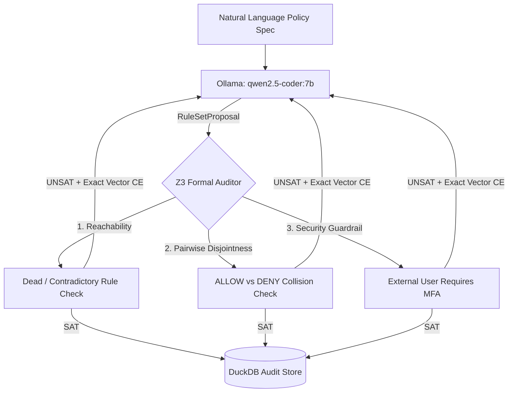

# abstract-ops — Formal Policy & Rule-Set Auditor (CEGIS)

Нейро-символический аудитор декларативных политик доступа (RBAC) и финансового андеррайтинга. Компилирует JSON-правила, сгенерированные локальной LLM, в SMT-формулы Z3 для математического доказательства непротиворечивости.

## Архитектура аудита



## Классы обнаруживаемых дефектов
* **Dead Rules:** правила с внутренне противоречивыми условиями (например, `amount > 50000` и `amount < 10000`).
* **Policy Ambiguity:** пересечение областей истинности `ALLOW` и `DENY` на одном приоритете с выдачей точного контрпримера из пространства признаков.
* **Security Invariant Breach:** формальное доказательство невозможности получения `ALLOW` при `is_external == True` и `mfa_verified == False`.

## MCP-инструменты (`FastMCP` / `stdio`)
* `audit_policy_ruleset` — детерминированный аудит набора правил `RuleSetProposal` через Z3.
* `synthesize_verified_policy` — синтез формально непротиворечивой политики из текстового ТЗ в цикле CEGIS.

## Запуск и QA-гейт
```bash
docker compose build auditor
docker compose run --rm auditor sh -c "ruff check src tests && mypy src tests && pytest -v"
docker compose run --rm auditor python -m abstract_ops.cegis
```
