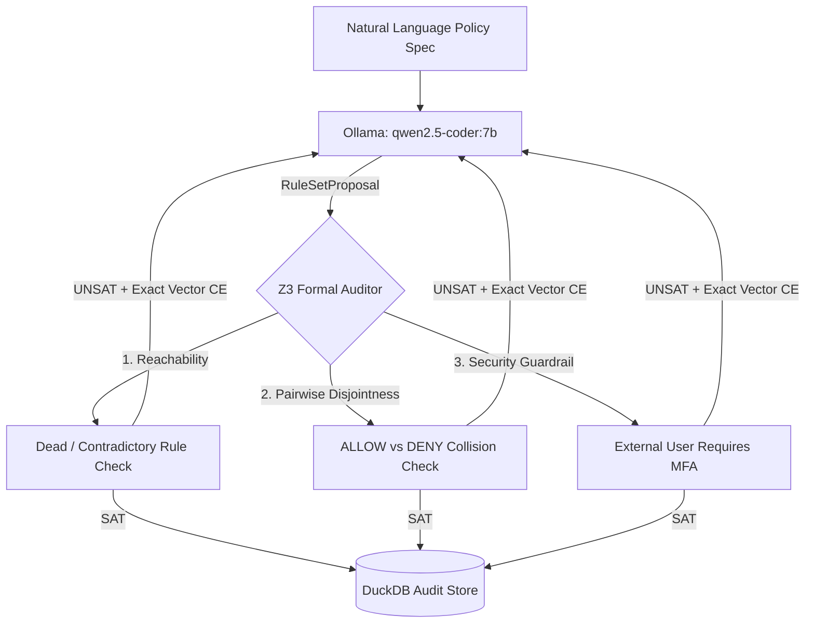

# abstract-ops — Formal Policy & Rule-Set Auditor (CEGIS)

Neuro-symbolic auditor for declarative access-control (RBAC) and financial underwriting policies. Compiles JSON rule-sets generated by a local LLM into Z3 SMT formulas to mathematically prove consistency and safety compliance.

> Part of the [`sandbox-init`](https://github.com/spanskikh/sandbox-init) neuro-symbolic cluster. See [`docs/ARCHITECTURE.md`](https://github.com/spanskikh/sandbox-init/blob/main/docs/ARCHITECTURE.md) for system design and ADRs.

## Audit Pipeline Architecture


## Defect Classes Detected
* **Dead Rules:** Unreachable rules containing internally contradictory predicates (`amount > 50000` AND `amount < 10000`).
* **Policy Ambiguity:** Overlapping `ALLOW` and `DENY` activation regions at the same priority level, returning an exact counterexample.
* **Security Invariant Breach:** Formal proof that `ALLOW` is unreachable whenever `is_external == True` and `mfa_verified == False`.
* **Shadowed / Subsumed Rules (CR-002):** Formal proof (`UNSAT(e2 and not e1)`) detecting redundant rules completely covered by broader rules.

## Sample CEGIS Execution
```text
Iteration 1 -> UNSAT: Security invariant violated (is_external=True, mfa_verified=False -> ALLOW)
Iteration 2 -> SAT: Policy converged with explicit MFA enforcement and disjoint ALLOW/DENY bounds
```

## MCP Tools (`FastMCP` / `stdio`)
* `audit_policy_ruleset` — Deterministic Z3 verification of a `RuleSetProposal` payload.
* `synthesize_verified_policy` — End-to-end CEGIS synthesis of a conflict-free policy from natural language specs.

## Quickstart & QA Gate
```bash
docker compose build auditor
docker compose run --rm auditor sh -c "ruff check src tests && mypy src tests && pytest -v"
docker compose run --rm auditor python -m abstract_ops.cegis
```
