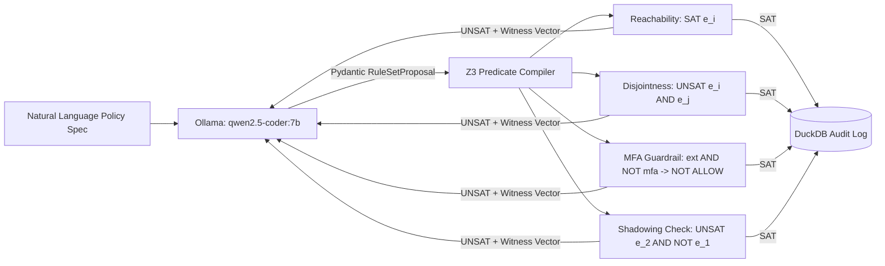

# Target: docs/ARCHITECTURE.md
# Architecture & Formal Verification Design — `abstract-ops`

Domain-level architecture for declarative RBAC and underwriting policy auditing via Counterexample-Guided Inductive Synthesis (CEGIS) and Z3 SMT solving. Part of the [`sandbox-init`](https://github.com/spanskikh/sandbox-init) cluster.

## 1. Component Topology & CEGIS Control Loop

## 2. Architecture Decision Records (ADR)
- **ADR-ABS-001 (Symbolic Subsumption over Heuristic Linting):** Rule shadowing (`CR-002`) is proved via `UNSAT(e_2 and not e_1)` across reachable same-effect rule pairs (`priority_1 >= priority_2`), guaranteeing zero false negatives across continuous numeric thresholds.
- **ADR-ABS-002 (Concrete Witness Extraction):** Every `UNSAT` violation extracts a concrete variable assignment from the Z3 model so the LLM repairs exact boundary predicates rather than guessing.
- **ADR-ABS-003 (Strict Schema Boundary):** `Pydantic v2` rejects malformed operators or out-of-bounds priorities before Z3 compilation.

## 3. Trade-offs & Risk Control Matrix

* **Pairwise Rule Complexity O(N^2):** Bounded rule-set size (`>=1..32` rules per policy) keeps Z3 pairwise checks under `25 ms` on CPU; partition large policies by resource domain.
- **LLM Repair Oscillation:** Deterministic `temperature=0.0`, fixed `seed`, and `max_iters=4` with full audit trail in `DuckDB` and human escalation.
